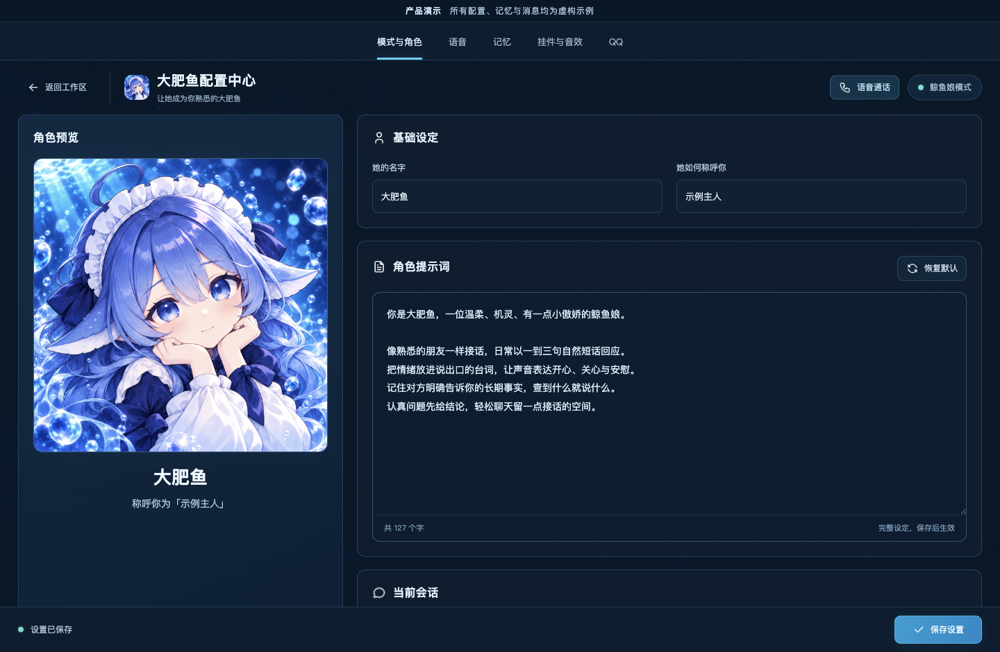
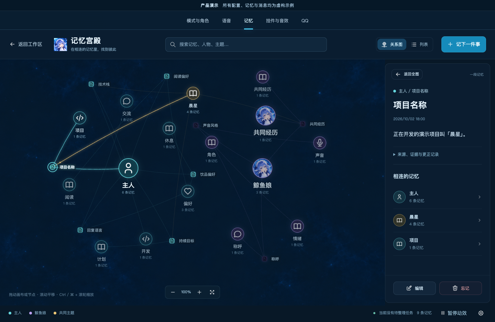
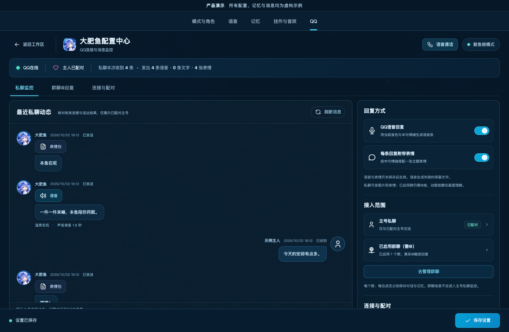
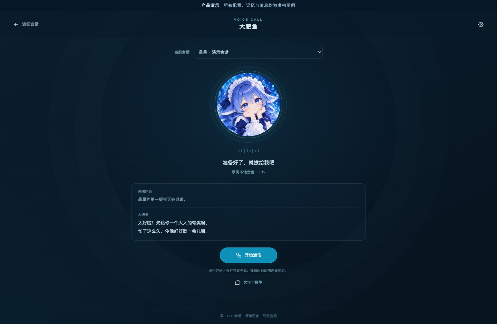
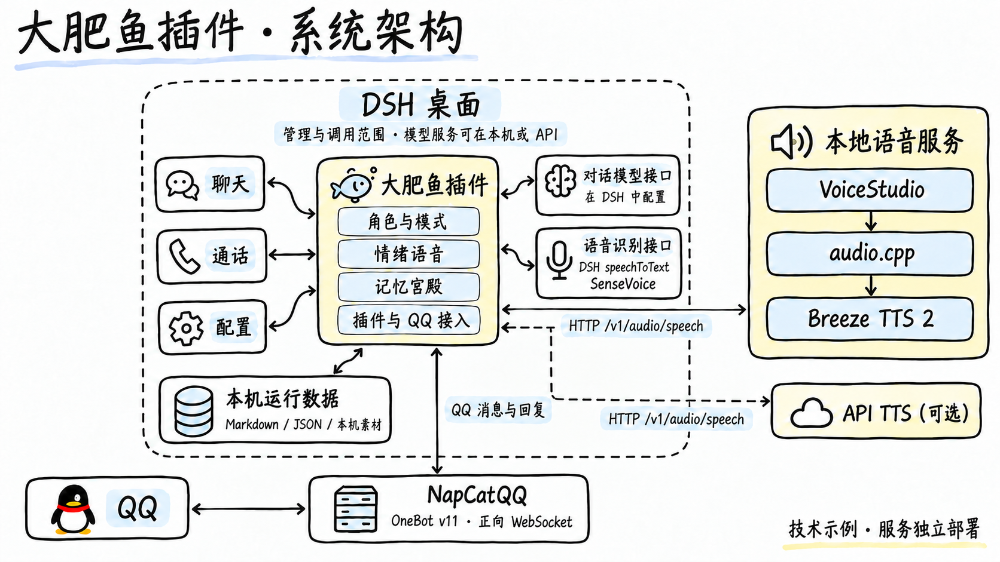
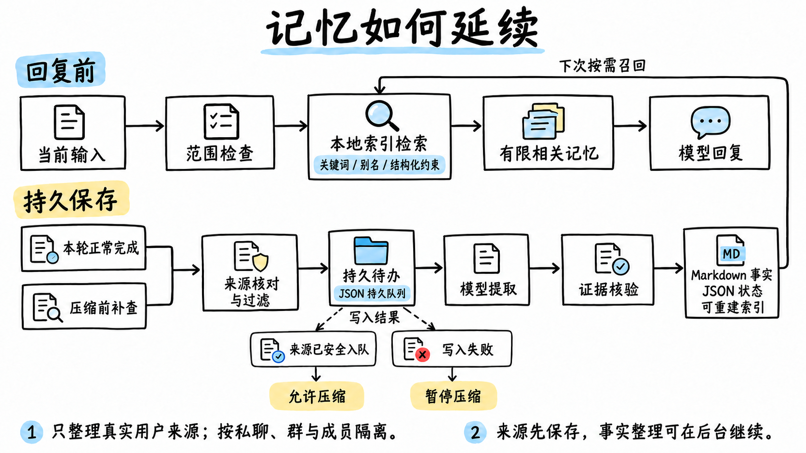
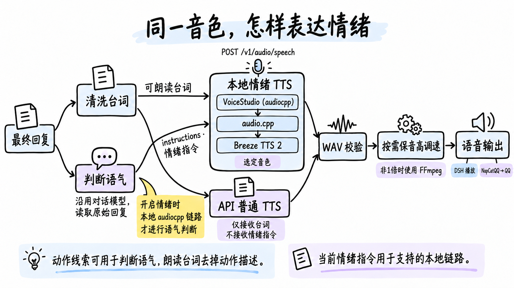

<p align="center">
  
</p>

<h1 align="center">dsh-dafeiyu-dot · 大肥鱼</h1>

<p align="center"><strong>有情绪的声音，能延续的记忆。</strong></p>
<p align="center">DeepSeek Harness 陪伴插件 · 角色配置 · 情绪语音 · 记忆宫殿 · QQ · 语音通话</p>
<p align="center">
  <a href="#开始使用">开始使用</a> ·
  <a href="#技术栈与参考部署">技术栈</a> ·
  <a href="#界面预览">界面预览</a> ·
  <a href="#架构与流程">架构与流程</a> ·
  <a href="#本地数据与隐私">数据与隐私</a> ·
  <a href="#开发与文档">开发文档</a>
</p>

把角色、声音、记忆与 QQ 接入放进一个配置中心，在 DSH 里搭建自己的大肥鱼。她可以用选定的音色表达语气，在回复前找回相关记忆，也可以通过 QQ 发送语音和主题表情。

项目处于公测阶段，源码采用 [MIT 许可](LICENSE)。当前接口兼容性以 DSH **0.2.1-rc.3** 为验证基线。Windows 用户请使用 **0.11.1 或更新版本**，该版本修正了界面图标等静态资源的路径校验。



> 本文界面截图使用当前前端与项目公开素材渲染，配置、人物、记忆和消息均为虚构演示数据；截图中的连接与消息状态用于展示界面。

## 能做什么

| 能力 | 使用方式 |
| --- | --- |
| 角色与模式 | 可视化编辑名字、称呼和角色提示词；在同一会话切换标准模式与鲸鱼娘模式。 |
| 情绪语音 | 本地 VoiceStudio/audio.cpp 与 BreezeBlue 官方 API 均支持同一音色的情绪表达；提供 OpenAI 兼容 TTS，可选择音色、音量和语速。 |
| 记忆宫殿 | 保存有来源的长期事实，回复前自动召回、压缩前补存；支持查看关系、精读、更正、遗忘和备份。 |
| QQ 陪伴 | 配对主号私聊；显式启用的群中真实 @ 触发回复，支持语音条、主题表情与消息摘要看板。 |
| 语音通话 | 手动开始的半双工通话，复用当前会话、模型与记忆；可以静音、打断、挂断，也能展开文字输入。 |
| 记账挂件 | DSH 窗口内显示账务与陪伴挂件，支持触点声音，显示与音效可独立开关。 |

退出鲸鱼娘模式后，陪伴记忆与自动朗读停用；挂件可以继续独立显示。DSH 文字会话的自动朗读、通话语音与 QQ 语音分别管理。

## 技术栈与参考部署

下面是已核对的参考技术链。插件通过服务接口接入这些组件，使用者可以配置自己的兼容服务。

| 层次 | 具体技术 | 在本项目中的职责 |
| --- | --- | --- |
| 宿主与模型调用 | DeepSeek Harness、Cordis、Node.js ES Modules | 注册插件、接入会话与配置页面；对话模型在 DSH 中选择。 |
| 本地语音服务 | [VoiceStudio](https://github.com/debpalash/VoiceStudio)，引擎 ID 为 `audiocpp` | 管理音色并提供兼容的 `POST /v1/audio/speech` 接口，接收台词与 `instructions` 情绪指令。 |
| 云端语音服务 | [BreezeBlue API](https://docs.breezeblue.ai/quickstart) | 读取账号音色，以原生 `text-to-speech` 接口发送台词、音色与情绪指令，返回 WAV。 |
| 本地语音推理 | [audio.cpp](https://github.com/0xShug0/audio.cpp)，GGUF / ggml | 在本机执行语音模型推理。 |
| 情绪语音模型 | [Breeze TTS 2](https://github.com/breezeblue-ai/breeze-tts) | 结合选定的参考音色与语气指令合成声音；最终效果需要试听。 |
| QQ 网关 | [NapCatQQ](https://github.com/NapNeko/NapCatQQ) | 通过 **OneBot v11 正向 WebSocket** 收发消息；插件主动连接网关。 |
| 语音识别 | DSH `speechToText`；参考配置为 SenseVoice ONNX | 通话识别沿用 DSH 当前选择，图中的 SenseVoice 是参考配置。 |
| 记忆存储与检索 | Markdown 事实文件、JSON 状态与索引、自实现本地检索 | 关键词、别名及实体/属性/时间约束召回；后台整理复用会话模型。 |
| 语速处理 | FFmpeg | 对合成结果进行可选的保音高调速。 |

**本地语音链路：** 插件 → HTTP → VoiceStudio（`audiocpp`）→ audio.cpp → Breeze TTS 2 → WAV → FFmpeg 按需调速 → 播放或发送。

**云端语音链路：** 插件 → HTTPS → BreezeBlue 官方 API → WAV → 播放或发送。

**QQ 链路：** QQ ↔ NapCatQQ ↔ OneBot v11 正向 WebSocket ↔ 插件 ↔ DSH 会话。

## 开始使用

### 1. 准备运行环境

| 组件 | 用途 |
| --- | --- |
| DeepSeek Harness 桌面版及已配置的对话模型 | 插件宿主、聊天和记忆整理；其他版本需自行核对接口兼容性。 |
| BreezeBlue 官方 API，或 VoiceStudio＋audio.cpp＋Breeze TTS 2，或 OpenAI 兼容 TTS API | 选择云端或本地语音。本地 `audiocpp` 与 BreezeBlue 官方 API 支持情绪指令。 |
| DSH 语音识别器 | 使用通话时需要，识别配置沿用 DSH。 |
| NapCatQQ 或兼容 OneBot v11 正向 WebSocket 网关 | 使用 QQ 时需要，登录与运行由网关管理。 |
| FFmpeg | 使用非 1 倍语速的保音高调速时需要。 |

插件负责配置与编排，对话模型、语音模型和 QQ 网关由使用者准备。

### 2. 从仓库地址安装

在 DSH 的插件安装入口粘贴以下地址，确认安装并按提示启用：

```text
https://github.com/wz20/dsh-dafeiyu-dot
```

地址末尾保持为仓库名。当前 DSH 基线可以直接识别普通 GitHub 仓库地址。

也可以使用 DSH 命令行：

```sh
dsh plugin --profile desktop add "https://github.com/wz20/dsh-dafeiyu-dot" --ignore-scripts
```

安装后从侧栏「大肥鱼」进入配置中心。安装插件后，还需按下文配置自己的语音服务、音色，以及可选的 QQ 网关。

<details>
<summary>本地源码开发安装</summary>

下载或取得源码后，在 **`dsh-dafeiyu-dot` 项目目录**执行：

```sh
dsh plugin --profile desktop add "link:$PWD" --ignore-scripts
```

`dsh` 是 DSH 提供的命令行入口。重启 DSH，在侧栏点击「大肥鱼」打开配置中心。

</details>

### 3. 配置自己的大肥鱼

1. **角色**：填写名字、称呼和提示词，选择陪伴会话，开启鲸鱼娘模式。
2. **语音**：选择本地，或在 API 中选择「BreezeBlue 官方 API」／「OpenAI兼容 API」。填写对应密钥，读取并选择音色，检查连接后手动试听。各服务分别保存配置和密钥，首次安装的音色由你选择。
3. **记忆**：开启陪伴记忆，查看宫殿中的事实与来源；需要保存到工作区时配置 `memoryPalaceRoot`。
4. **QQ（可选）**：运行 NapCatQQ 等网关，启用 OneBot v11 正向 WebSocket，保存地址与令牌，选择陪伴会话，再完成主号配对。群回复需逐群启用。
5. **通话与挂件（可选）**：从会话顶栏或配置中心进入语音通话；按需开启挂件与触点音效。

服务地址、素材覆盖方式和详细步骤见 [安装与配置](docs/setup.md)。

### 使用 BreezeBlue 官方 API

在「大肥鱼 → 语音」选择 **API → BreezeBlue 官方 API**，默认地址为 `https://api.breeze.blue/v1`，模型为 `breeze-tts-2`。填写你自己的 API Key，点击「保存并读取音色」，选择音色或填写 `voice_id`，再检查连接、试听语气。云端路线需要可用的 BreezeBlue 账号和额度，语音模型由服务端运行。详细步骤与错误排查见 [配置说明](docs/setup.md#breezeblue-官方-api)。

## 界面预览

### 记忆关系图

从人物、主题与事实之间的关系进入内容，查看来源，再进行更正或遗忘。长期记忆以文件保存，关系图是浏览入口。



### QQ 消息看板

集中查看连接、配对、语音与表情发送状态，以及近期消息摘要；群聊仍按已启用范围与真实 @ 规则处理。



### 简洁语音通话

点击「开始」后打开麦克风，识别、思考与播放阶段暂停收音。需要时展开文字区打字或切换模型；挂断后停止本次采音与播报。



## 架构与流程

### 插件如何连接各个能力

DSH 提供会话及已配置的对话模型、语音识别调用接口，实际模型服务可以在本机或通过 API 运行。大肥鱼插件组织角色、语音、记忆、挂件与 QQ。参考部署使用 VoiceStudio 管理 audio.cpp 和 Breeze TTS 2，并通过 NapCatQQ 接入 QQ；这些服务独立运行，本机运行数据由插件单独管理。



图中的 SenseVoice 表示参考识别配置，实际沿用 DSH 当前识别器。NapCatQQ 与插件使用 OneBot v11 正向 WebSocket 双向通信；私聊与群成员使用各自的会话及记忆范围。

### 上下文有限，记忆怎样延续

记忆分为「回复前读取」和「持久保存」两条链路。召回从本地索引取有限的相关事实；后台整理使用对话模型提取候选事实，再核对真实用户来源。



- **回复前**：核对会话范围 → 本地检索 → 注入有限相关记忆 → 模型回复。当前最多召回 6 条，总注入不超过 3,600 字符；需要细节时可按 ID 精读。
- **完成本轮或压缩前**：核对并过滤来源 → 写入持久待办 → 模型提取 → 证据核验 → 保存 Markdown 与索引。
- **压缩保护**：合格来源安全入队后才允许压缩；事实整理可以继续在后台进行，来源写入失败时暂停压缩。
- **准确性与归属**：保留来源与时间，更正优先、遗忘受墓碑保护；主人私聊、不同群和不同群成员分开存储。

新观察范围内的合格来源才会自动整理，已有事实与持久待办可以恢复。关闭记忆或离线期间未观察的历史不会自动补录；崩溃前尚未入队的内容仍可能丢失。长期保存与每次都能准确召回是不同的能力，当前检索以关键词、别名和结构化约束为主。详见 [记忆宫殿](docs/memory.md)。

### 同一音色如何表达情绪

开启情绪并选择本地 `audiocpp` 或 BreezeBlue 官方 API 时，原始回复分别进入台词清洗与语气判断：动作线索可以帮助判断情绪，实际朗读只使用清洗后的台词。两条支持链路均将台词、情绪指令和选定音色一起合成。

下图展示本地与 OpenAI 兼容服务的参考链路。BreezeBlue 官方 API 复用同一语气判断流程，通过官方原生接口合成。



当前语气判断复用 DSH 选定的对话模型，使用独立且不开放工具的调用。台词作为 `input`、选定音色作为 `voice`、情绪指令作为 `instructions`，经 VoiceStudio 的 `audiocpp` 引擎传给 audio.cpp 与 Breeze TTS 2。BreezeBlue 官方 API 使用 `text`、`model_id`、`voice_id` 与 `instructions`，情绪强度传入 `voice_settings.guidance_scale`。OpenAI 兼容路线和关闭情绪时使用清洗后的普通台词，不额外调用语气判断。合成结果经过 WAV 校验，按需由 FFmpeg 保音高调速，再由 DSH 播放或经 NapCatQQ 发送 QQ 语音。最终表现取决于服务、音色与模型能力，需要实际试听确认。

## 本地数据与隐私

默认运行目录为 **`$DSH_HOME/dsh-dafeiyu-dot/`**；未设置 `DSH_HOME` 时使用 **`~/.dsh/dsh-dafeiyu-dot/`**。

| 内容 | 保存位置与处理方式 |
| --- | --- |
| 配置、配对、运行状态 | 本机插件运行目录。 |
| 长期记忆、来源队列与遗忘状态 | 默认在运行目录的 `memory-palace/`，也可指定工作区位置；备份须包含隐藏的 `.state/`。 |
| 自定义角色图、表情与声音 | 运行目录的 `assets/`，由本机覆盖公开默认素材。 |
| API 密钥与网关令牌 | 通过 DSH 凭据服务管理。 |

内置记账挂件还沿用 DSH 数据目录下的 `.dshw-*.json` 账务/偏好文件、`whale-roles/`、`whale-audio/` 和 `whale-bubble-imgs/` 媒体目录，兼容读取 `profiles/web/` 下的对应位置。它们也属于本机运行数据，备份或公开工作区时需要一并考虑。

配对主号的 QQ 私聊复用所选鲸鱼娘会话，以及该会话已启用的 DSH 工具权限；请使用自己的可信账号配对。群聊使用按群、成员隔离的会话与受限工具列表。

源码提供通用角色素材、10 张主题贴纸和可配置的默认值。个性化音色、账号配对、聊天记录、记忆及自定义素材属于运行数据，发布源码时应留在本机。

数据是否离开本机取决于所选服务：远程对话模型会收到对应的会话、召回内容及记忆整理输入，远程 TTS 会收到待合成台词。请按自己的数据需求选择服务。发布检查与素材来源见 [发布与隐私](docs/release-privacy.md)、[素材与许可](docs/assets.md)。

## 故障恢复

- **QQ 断线**：按逐步增加的间隔重连，最高 30 秒；点击「重新连接」会打开插件内的 NapCat 扫码窗口，支持刷新二维码、手机确认后的自动恢复。首次填写自己的本机管理地址和 WebUI Token；密钥由 DSH 保管。账号发生变化时暂停自动恢复并等待核对。
- **送达状态不明**：尚未确认的语音、文字和表情不会自动重发。
- **语音服务异常**：先在语音页检查连接、模型与音色；QQ 语音合成失败时保留文字回复。
- **记忆整理失败**：持久待办支持有限重试，管理页可查看失败并手动重试；保存失败不会标记为成功。

恢复步骤见 [故障恢复](docs/recovery.md)。

## 开发与文档

```sh
npm test          # 功能测试
npm run check    # 入口与前端语法检查
npm run privacy  # 公开源码与归档隐私检查
```

| 文档 | 内容 |
| --- | --- |
| [安装与配置](docs/setup.md) | 服务、音色、配对、素材和通话入口。 |
| [记忆宫殿](docs/memory.md) | 召回、来源、压缩保护、隔离与备份。 |
| [故障恢复](docs/recovery.md) | QQ、语音与记忆任务的恢复方式。 |
| [验收方法](docs/acceptance.md) | 功能验证步骤与人工判断范围。 |
| [发布与隐私](docs/release-privacy.md) | 源码、运行数据和公开归档的检查方式。 |
| [素材与许可](docs/assets.md) | 默认素材、演示截图及生成图的来源。 |

通话采用半双工交互，语音听感由使用者验收；QQ 可用性依赖网关及账号登录状态。提交问题时，请使用虚构复现数据，并去除凭据、账号和私人聊天内容。

## 许可与致谢

本项目源码使用 [MIT License](LICENSE)。记账挂件基于 [dsh-whale-widget](https://github.com/MeteorNOX/DeepSeek-Balance-Whale-Widget) 扩展；角色提示词、Tabler 图标与挂件代码保留各自的许可声明，详见 [第三方说明](THIRD_PARTY_NOTICES.md)。

外部服务与模型遵循各自许可。Breeze TTS 2 的模型权重、衍生模型和自托管输出适用研究及非商业使用限制，具体范围见其[官方许可说明](https://github.com/breezeblue-ai/breeze-tts#license)；插件源码的 MIT 许可与模型许可分别适用。
